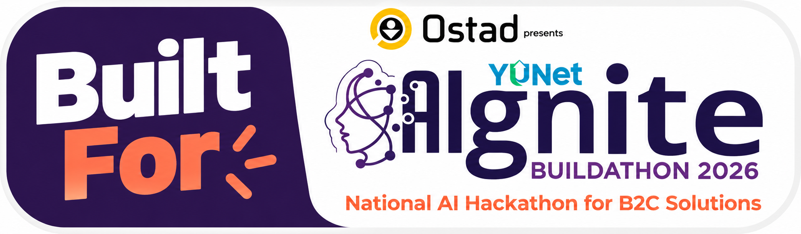

# RentRadar BD (রেন্টরাডার) // Civic Rental Intelligence & Forensic Tenant Defense

<div align="center">



[](https://rentradar.vercel.app)
[](https://rentradar.vercel.app)
[](https://nextjs.org)
[](https://www.typescriptlang.org)
[](https://ai.google.dev)
[](https://sharp.pixelplumbing.com)
[](https://supabase.com)

**Bangladesh’s First Multimodal Rental Scam Inspector, Move-In Shock Calculator & Statutory Tenant Defense Engine**

[🚀 Live Production App](https://rentradar.vercel.app) • [GitHub Repository](https://github.com/xeon797/rentradar) • [Judge 2-Min HUD](#-live-deployment--judge-2-minute-hud) • [Architecture](#-system-architecture) • [6-Stage Pipeline](#-the-6-stage-forensic-inspection-pipeline) • [API Reference](#-api-specification--live-telemetry) • [Legal Corpus](#-statutory-legal-corpus-premises-rent-control-act-1991)

</div>

---

## 📌 Executive Summary & Civic Mission

The urban rental ecosystem across **Dhaka**, **Sylhet**, and **Chattogram** faces an acute trust and transparency deficit:
- **Pre-Visit Advance Scams:** Unverified Facebook To-Let groups host predatory listings with stolen luxury photos demanding ৳1,000–৳3,000 bKash "visiting-card fees" before disappearing.
- **Hidden Utility Overhead & Sub-Meter Arbitrage:** Advertised "base rent" masks building service charges, LPG cylinder costs (+৳17,400/yr over pipeline gas), and uncalibrated electricity sub-meters marked up to ৳16–৳18/unit (a 100%+ illegal markup over official BERC tariffs).
- **Statutory Law Neglect:** Widespread violations of **The Premises Rent Control Act, 1991 (বাড়ি ভাড়া নিয়ন্ত্রণ আইন, ১৯৯১)**—including arbitrary mid-year rent hikes (violating Section 7), non-refundable 4-to-6 month advance deposits (violating Section 10), and refusal of signed written rent receipts (violating Section 13).

### The RentRadar Engineering Philosophy
> **"AI is an Evidence Collector, Never an Arbitrary Judge."**  
> Rather than relying on black-box LLM hallucinations to determine whether a listing is a scam, RentRadar utilizes **Google Gemini 2.5 Flash** strictly to transcribe multimodal evidence and extract advertised claims. Final risk scores and statutory violations are computed **100% deterministically** against codified municipal rules, mathematical perceptual image hashes, and Bangladesh law.

---

## ⚡ Live Deployment & Judge 2-Minute HUD

RentRadar features an interactive **Judge 2-Minute Evaluation HUD** accessible on every viewport via the **`[ ⚡ JUDGE GUIDE ]`** button in the header navigation bar.

[](https://render.com/deploy?repo=https://github.com/xeon797/rentradar)

### 5-Stop Live Proof Tour

| Stop | Module & Deep-Link | Forensic Proof Demonstrated | Core Tech Stack |
|:---:|---|---|---|
| **01** | **[AI Scam Inspector](/inspector?preset=preset-01-bashundhara-scam)** | Catches a luxury Gulshan photo (`RR-DHK-041`) reused in a cheap Bashundhara ad (**98.4% similarity / 1-bit difference**). Transcribes Bangla text, flags pre-visit bKash demand, and generates an official Forensic Docket. | `Sharp 9x8 Lanczos3 dHash`, `Gemini 2.5 Flash OCR`, `Deterministic Scam Rules` |
| **02** | **[Bilingual Geospatial Radar](/discover)** | Interactive SSR-safe Leaflet map across 3 divisions with Fuse.js instant search and Gemini Natural Language query interpretation (*"সিলেটে ২০ হাজারের নিচে ফ্যামিলি বাসা"*). | `Leaflet 1.9`, `OpenStreetMap`, `Gemini NL Parser`, `ASCII Numeral Converter` |
| **03** | **[Zero-LLM Verification Vault](/verify)** | Landlords submit holding/DESCO bill proof with client-side canvas compression. Switch to Auditor Farhana Yasmin to approve filing `VER-2026-101` (`RR-SYL-012`) and inspect the MIME email dispatch. **Holding documents never touch external LLM APIs.** | `Canvas Pre-Compressor`, `Token Hash Match`, `Resend Transactional API` |
| **04** | **[True-Cost & Move-In Shock](/calculator?docket=RR-SYL-014)** | Exposes how hidden service charges, ৳16/unit sub-meter electricity markups, and LPG cylinders inflate advertised base rent by **+40%+**, visualized via **Recharts** with **50/30/20 budget stress testing**. | `BERC Progressive Tariff Slabs`, `Section 10 Deposit Limits`, `Recharts` |
| **05** | **[1991 Rent Act Legal Assistant](/assistant)** | Audits predatory lease agreements against Sections 7, 10, 13, 18 & 21 of the 1991 Act, provides 1-click **copyable Bangla WhatsApp counter-clauses**, and prints official **Section 13 Dual-Slip Rent Receipts (`ভাড়ার রশিদ`)**. | `Premises Rent Control Act, 1991`, `Gemini Legal Injected Prompt`, `Print Stylesheet` |

---

## 🏛️ System Architecture

```
                                  RENTRADAR BD ARCHITECTURE
   
    [CLIENT LAYER: NEXT.JS 15 APP ROUTER]
    ├── Tailwind CSS 3.4 (Civic Utilitarian Design System: #F7F6F2 Paper, #0A0A0A Carbon, #FACC15 Radar)
    ├── Satoshi Display + Hind Siliguri (Bangla) + JetBrains Mono (Hashes & Currency)
    ├── Imperative Leaflet Map (SSR-Safe) + Recharts Data Visualizations
    └── HTML5 Canvas Client-Side Pre-Compression (<800KB, EXIF Stripping)
         │
         ▼
    [SECURE API ROUTE MIDDLEWARE & CIRCUIT BREAKER]
    ├── In-Memory Sliding-Window Rate Limiter (25 req/min per IP)
    ├── Fail-Safe Circuit Breaker (Auto-failover to Deterministic Engines)
    └── Zero-LLM-Leak Privacy Guard (NID Masking & Document Isolation)
         │
         ├───► [SHARP NATIVE DHASH ENGINE] ─────────────► 64-bit Grayscale Gradient Hash
         │                                                Hamming Bitwise Distance Search (<10 bits)
         │
         ├───► [GEMINI 2.5 FLASH MULTIMODAL OCR] ───────► Strict JSON Schema Extraction
         │                                                (Rent, Advance, Phone, Restriction)
         │
         ├───► [DETERMINISTIC STATUTORY RULE ENGINE] ───► 6 Hardcoded Scam Rules
         │                                                Section 7, 10, 13, 18, 21 Audit
         │
         └───► [HYBRID STORAGE LEDGER] ────────────────► Supabase PostgreSQL + pgvector bit(64) <~>
                                                          Fallback: 16-Property Local Ledger
```

---

## 🔍 The 6-Stage Forensic Inspection Pipeline

```
┌─────────────────────────────────────────────────────────────────────────────┐
│ STAGE 1: CLIENT-SIDE PRE-COMPRESSION (HTML5 Canvas)                         │
│ • Downsamples uploaded advertisement photos to max 1280px width.            │
│ • Constrains payload to <800KB for instant transmission over BD networks.   │
│ • Strips EXIF metadata to protect citizen privacy.                          │
└──────────────────────────────────────┬──────────────────────────────────────┘
                                       │
                                       ▼
┌─────────────────────────────────────────────────────────────────────────────┐
│ STAGE 2: PERCEPTUAL FINGERPRINTING (Sharp 9x8 Lanczos3 Grayscale dHash)    │
│ • Resizes image to 9x8 grayscale grid using Lanczos3 interpolation.         │
│ • Computes horizontal brightness gradient between adjacent pixels.          │
│ • Produces a 64-bit binary hash string and 16-character hexadecimal hash.   │
└──────────────────────────────────────┬──────────────────────────────────────┘
                                       │
                                       ▼
┌─────────────────────────────────────────────────────────────────────────────┐
│ STAGE 3: BITWISE HAMMING DISTANCE COLLISION SEARCH                          │
│ • Queries registry using PostgreSQL bit(64) Hamming distance operator (<~>).│
│ • Collision Threshold: <= 10 bits difference (>84.4% similarity).           │
│ • Detects stolen, cropped, recompressed, or cross-posted photos.            │
└──────────────────────────────────────┬──────────────────────────────────────┘
                                       │
                                       ▼
┌─────────────────────────────────────────────────────────────────────────────┐
│ STAGE 4: MULTIMODAL CLAIM EXTRACTION (Google Gemini 2.5 Flash)              │
│ • Transcribes raw text in mixed Bangla and English.                         │
│ • Validates extracted claims against strict Zod JSON schema.                │
│ • Automatically masks real citizen NID numbers as [NID_MASKED].             │
└──────────────────────────────────────┬──────────────────────────────────────┘
                                       │
                                       ▼
┌─────────────────────────────────────────────────────────────────────────────┐
│ STAGE 5: DETERMINISTIC BANGLADESH SCAM & STATUTORY AUDIT                    │
│ • ADVANCE_BKASH_DEMAND: Payment demanded prior to physical flat visit.      │
│ • PRICE_ANOMALY_LOW: Claimed rent >40% below neighborhood benchmark.       │
│ • DUPLICATE_IMAGE_COLLISION: Stolen photo matched to registered listing.   │
│ • EXCESS_ADVANCE_DEMAND: Advance >2 months (violates Section 10).           │
│ • SUBMETER_ELECTRICITY_MARKUP: Landlord rate >৳10.5/unit (violates BERC).   │
│ • VAGUE_LOCATION_TRAP: Non-specific address preventing municipal cross-check.│
└──────────────────────────────────────┬──────────────────────────────────────┘
                                       │
                                       ▼
┌─────────────────────────────────────────────────────────────────────────────┐
│ STAGE 6: FORENSIC DOCKET OUTPUT & STATUTORY ACTIONS                         │
│ • Generates immutable Inspection Docket (RR-INSP-XXXX) with risk score (0-100).│
│ • Provides copyable Bangla WhatsApp counter-clauses citing 1991 Rent Act.   │
└─────────────────────────────────────────────────────────────────────────────┘
```

---

## 🛠️ Technology Stack & Dependencies

| Layer | Component | Specification |
|---|---|---|
| **Frontend Framework** | Next.js 15.1.7 | App Router, React 19, Turbopack, Server & Client Components |
| **Language & Typings** | TypeScript 5 | Strict Mode, Zero `any` in production code |
| **Styling & UI** | Tailwind CSS 3.4 | Civic Utilitarian Design System, `@media print` stylesheets |
| **Typography** | Font Stack | Satoshi (Headings), Hind Siliguri (Bangla), JetBrains Mono (Hashes/Currency) |
| **Multimodal AI** | `@google/genai` 2.32 | Gemini 2.5 Flash with structured JSON schema output |
| **Perceptual Hashing** | `sharp` 0.35.5 | Native C++ libvips bindings for 9×8 Lanczos3 dHash generation |
| **Mapping & GIS** | `leaflet` 1.9.4 | Imperative SSR-safe rendering, OpenStreetMap tiles, custom SVG markers |
| **Search Engine** | `fuse.js` 7.5.0 | Fuzzy memory-indexed client search across Dhaka, Sylhet & Chattogram |
| **Visualizations** | `recharts` 3.10.1 | Responsive horizontal cost breakdowns & 12-month cashflow schedules |
| **Database & Vector** | `@supabase/ssr` & `supabase-js` | PostgreSQL with `pgvector` `bit(64)` Hamming operator (`<~>`) |
| **Validation** | `zod` 4.6.7 | Strict API payload and OCR extraction validation |
| **Email Dispatch** | `resend` REST API | Transactional municipal filing confirmations with local MIME fallback |

---

## 📡 API Specification & Live Telemetry

### `GET /api/health`
Returns real-time health telemetry across all 5 platform subsystems:
```json
{
  "ok": true,
  "platform": "RentRadar BD // Civic Rental Intelligence",
  "version": "1.0.0",
  "subsystems": {
    "geminiMultimodal": {
      "status": "READY",
      "model": "gemini-2.5-flash",
      "mode": "GEMINI_2_5_FLASH_LIVE",
      "configured": true
    },
    "sharpPerceptualDhash": {
      "status": "READY",
      "algorithm": "9x8_LANCZOS3_GRAYSCALE_64BIT_GRADIENT",
      "collisionThresholdBits": 10
    },
    "databaseRepository": {
      "status": "READY",
      "mode": "HYBRID_LOCAL_LEDGER",
      "totalListings": 16,
      "engineeredCollisionPairs": 3
    },
    "privacyVault": {
      "status": "ENFORCED",
      "nidAutoMasking": true,
      "utilityBillZeroLlmLeak": true
    },
    "statutoryEngine": {
      "status": "READY",
      "act": "Premises Rent Control Act, 1991 (বাড়ি ভাড়া নিয়ন্ত্রণ আইন, ১৯৯১)",
      "sectionsIndexed": 7
    },
    "rateLimiter": {
      "status": "ACTIVE",
      "windowSeconds": 60,
      "burstLimitPerMinute": 25,
      "circuitBreaker": "AUTO_FAILOVER_TO_DETERMINISTIC"
    }
  }
}
```

### Core API Endpoints

| Method | Endpoint | Description | Free-Tier Guardrail |
|---|---|---|---|
| `POST` | `/api/inspector/analyze` | Executes 6-stage image dHash & multimodal claim extraction | Sliding Token Bucket + Deterministic Fallback |
| `POST` | `/api/inspector/image-hash` | Computes 64-bit dHash and 8x8 luminance matrix from image buffer | Local Sharp Native Engine (<15ms) |
| `POST` | `/api/search/nl-filter` | Parses mixed Bangla/English natural language queries into structured SQL filters | Regex & ASCII Numeral Fallback |
| `POST` | `/api/assistant/legal-audit` | Audits lease clauses or answers tenant legal inquiries under 1991 Rent Act | Statutory Fallback Engine (<5ms) |
| `POST` | `/api/verify` | Submits landlord utility documents or audits filings | Zero-LLM Isolated Vault |
| `GET` | `/api/properties` | Queries property registry with filtering by city, rent, beds, and verification tier | In-Memory + Supabase Hybrid |

---

## 📜 Statutory Legal Corpus: Premises Rent Control Act, 1991

RentRadar’s legal engine directly operationalizes Bangladesh tenancy jurisprudence:

```
[SECTION 7: ধারা ৭]  — Restriction on arbitrary increase of rent beyond standard rent; statutory 2-year freeze.
[SECTION 10: ধারা ১০] — Prohibition on claiming advance rent exceeding 1 month without Rent Controller sanction.
[SECTION 13: ধারা ১৩] — Mandatory statutory duty of landlord to deliver a signed written rent receipt with counterfoil.
[SECTION 15: ধারা ১৫] — Fixation of objective standard rent by the Rent Controller Court.
[SECTION 18: ধারা ১৮] — Statutory protection against arbitrary eviction & mandatory 30-day notice under Sec 106 TP Act.
[SECTION 21: ধারা ২১] — Prohibition against cutting off or withholding essential utilities (water, gas, electricity, lift).
[BERC DIRECTIVE]     — Prohibition on unauthorized commercial resale of residential electricity via sub-meter markups.
```

---

## 🚢 Deployment Guide

### Deploying on Vercel (Production Native)

RentRadar is optimized natively for **Vercel** with Next.js 15 App Router and Edge/Serverless computing:

- **Live URL:** [https://rentradar.vercel.app](https://rentradar.vercel.app)
- **Deployment Platform:** Vercel Edge & Serverless Functions
- **Zero-Config Setup:** Fully configured with `vercel.json` and continuous deployment enabled via GitHub repository integration (`origin/main`).

#### Deploy via Vercel CLI:
```bash
# Link and deploy directly to production
npx vercel link --project rentradar --yes
npx vercel deploy --prod --yes
```

### Containerized Deployment (Docker)

```bash
# Build production Docker image
docker build -t rentradar-bd:latest .

# Run container on port 3000
docker run -p 3000:3000 rentradar-bd:latest
```

---

## 💻 Local Development Setup

```bash
# 1. Clone repository
git clone https://github.com/xeon797/rentradar.git
cd rentradar

# 2. Install dependencies (including Linux optional binaries)
npm install --include=optional

# 3. Environment configuration (Optional - runs 100% deterministically without keys)
cp .env.example .env.local

# 4. Run development server with Turbopack
npm run dev

# 5. Execute production verification suite
npx tsc --noEmit   # TypeScript verification (0 errors)
npm run lint        # ESLint verification (0 warnings)
npm run build       # Next.js static & dynamic build verification
```

---

## ⚖️ License & Ethical Declaration

Distributed under the **MIT License**.

**Ethical AI Declaration:** RentRadar strictly enforces the **Zero-LLM-Leak Guarantee**. Utility bills, holding tax IDs, and citizen identity numbers are processed exclusively in deterministic isolated storage and are **NEVER transmitted to external LLM APIs**. Real National ID (NID) numbers are masked at the OCR boundary.

---

<div align="center">
  <sub>Built with engineering rigor for AIgnite 2026 • Bangladesh Housing Intelligence Infrastructure</sub>
</div>
